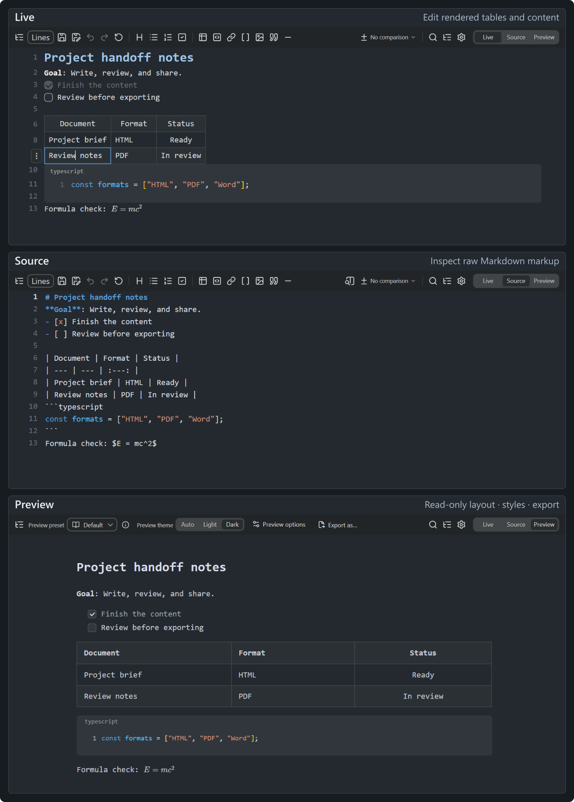
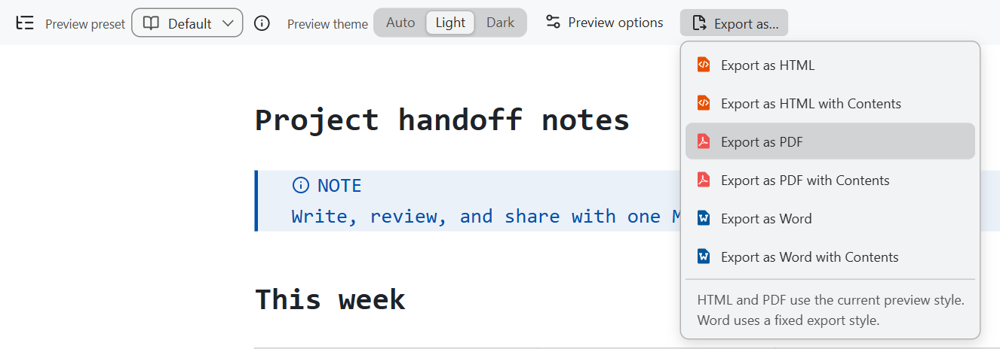
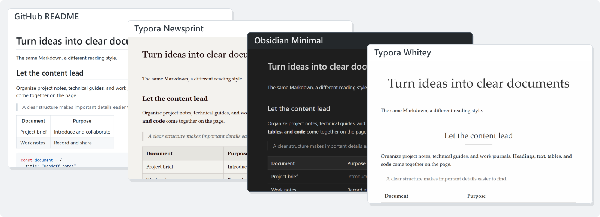
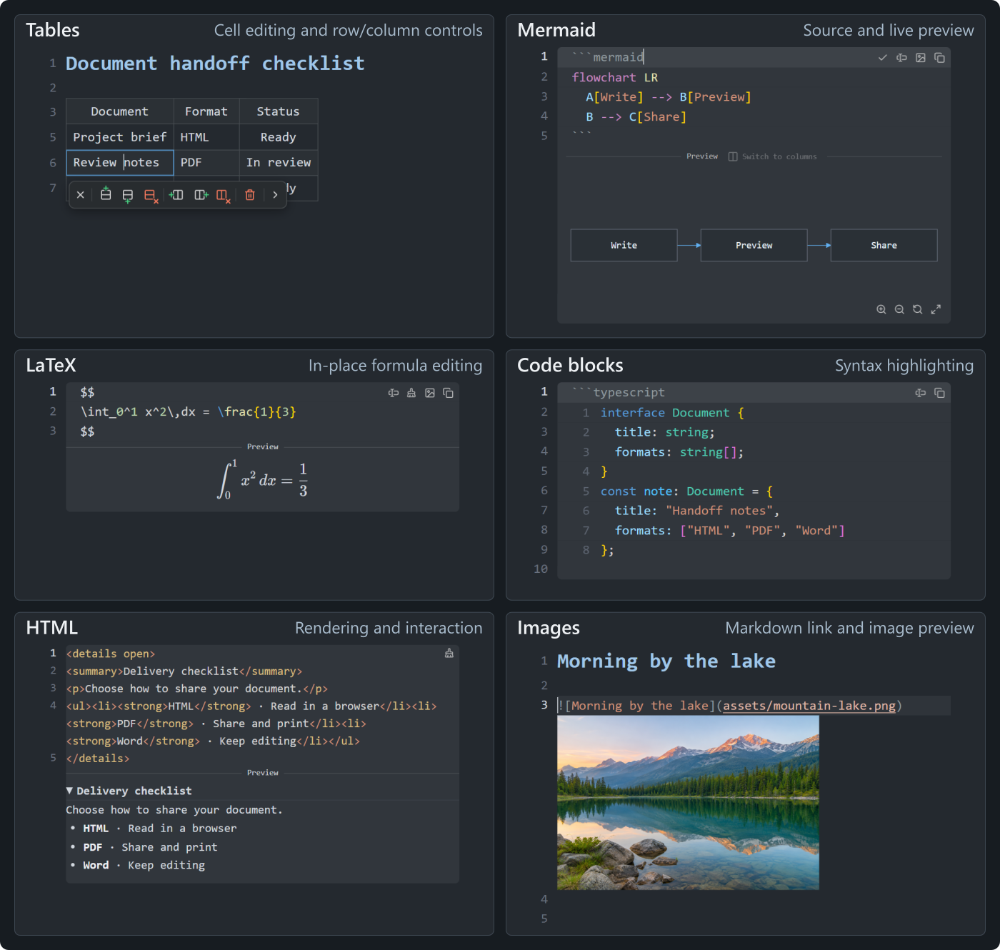
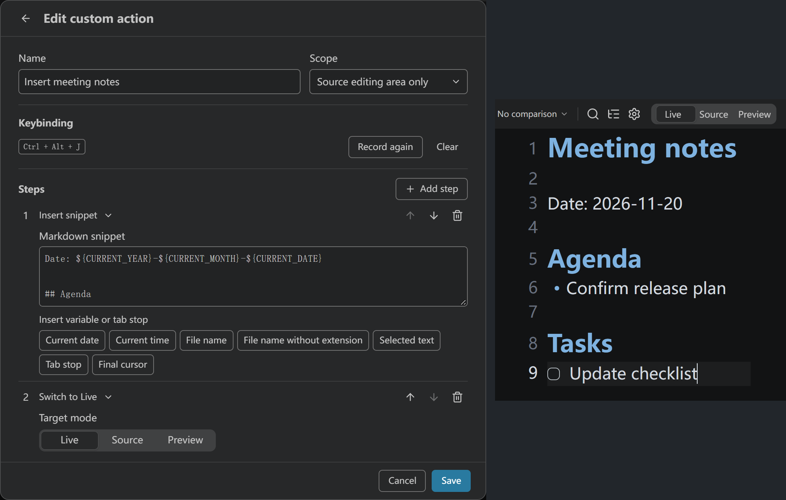
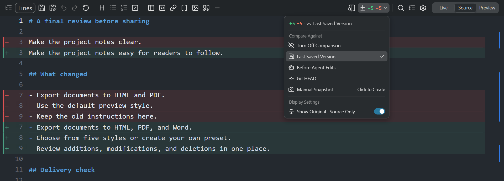

# MEO Enhanced

Write, preview, and review complex Markdown in VS Code. Move freely between Live, Source, and Preview modes, with in-place rendering and editing for tables, Mermaid diagrams, LaTeX formulas, HTML, and more.

在 VS Code 中流畅编写、预览和审阅复杂 Markdown。自由切换实时、源码与预览模式，在文档原位查看和编辑表格、Mermaid 图表、LaTeX 公式与 HTML 等内容。

<p align="center">
  <strong>English</strong> · <a href="https://github.com/huangko555/meo-enhanced/blob/main/README.zh-CN.md">简体中文</a> · <a href="https://github.com/huangko555/meo-enhanced/blob/main/CONTRIBUTING.md">Contributing</a>
</p>

<p align="center">
  <a href="https://marketplace.visualstudio.com/items?itemName=huangko555.meo-enhanced"><strong>Install from VS Code Marketplace</strong></a> ·
  <a href="https://github.com/huangko555/meo-enhanced/releases">Download VSIX</a> ·
  <a href="https://github.com/huangko555/meo-enhanced/blob/main/CHANGELOG.md">Changelog</a> ·
  <a href="#sponsor">Sponsor</a>
</p>


## One document, three ways to work

| Mode | What you can do |
| --- | --- |
| **Live** | Write directly in the rendered document and edit tables, images, diagrams, and formulas in place. |
| **Source** | Inspect the complete Markdown, adjust markup precisely, or work alongside a split preview. |
| **Preview** | Focus on reading, choose a preview style, and export your document. |

All three modes use the same content and preserve your reading position when switching. The Explorer's **MEO Outline** navigates headings in every mode. The status bar shows line and word counts, including selected words in Live and Source.



## Export to HTML, PDF, and Word

When your Markdown is ready, open Preview and choose **Export as…**. All three formats offer a **with table of contents** option.

| Format | When to use it | Export style |
| --- | --- | --- |
| **HTML** | Reading and sharing in a browser | Uses the current preview preset and colors |
| **PDF** | Sharing and printing with a fixed layout | Uses the preset with a paginated layout |
| **Word (.docx)** | Handing the document over for further editing | Uses a fixed document format |



## Choose a style, or make your own preset

Five built-in preview styles are available: **Default, GitHub README, Typora Newsprint, Typora Whitey, and Obsidian Minimal**. Give the same content the feel of a project README, a printed article, or a clean set of notes.



To customize fonts, colors, and layout, start with one of the examples in this repository:

1. Choose a style from the [preset guide and examples](preview-presets/README.md), then edit its configuration and CSS.
2. Select **Custom presets…** at the bottom of the preset menu and import your preset folder.
3. Choose the new preset in Preview, then export to HTML or PDF. You can also export preset files to share with others.

Presets apply to standalone Preview, Source split preview, and HTML/PDF exports. Live and Source retain the editor's appearance.

## Edit complex content in place



- **Tables**: Edit cells directly, add or remove rows and columns, adjust alignment and widths, and select or copy across cells. Long tables include a sticky header and toolbar.
- **Mermaid**: Open source and a live preview in the document, choose a stacked or side-by-side layout, and resize the split. Zoom, fullscreen viewing, and image/source copying are available.
- **LaTeX**: Click a block formula to edit its source and see the result immediately, with completion previews and formatting. You can also enable `\(...\)` and `\[...\]` math delimiters.
- **Code blocks and HTML**: Code blocks offer syntax highlighting, copying, and folding for long code. Supported safe HTML can be edited, previewed, and formatted in place.
- **Images**: Use local or remote images, or paste from the clipboard to save and insert a file automatically. Image folders and naming rules are configurable.

Also supports Frontmatter Properties, GitHub Alerts, footnotes, task lists, Wiki links, `==highlights==`, and merge conflict actions.

See the [settings and clipboard guide](docs/editing-preferences.md), [image folder and naming settings](docs/image-storage.md), and [custom preset guide](preview-presets/README.md) for more. The interface supports English and Simplified Chinese, light/dark appearances or the current VS Code theme, and adjustable font size and line spacing.

## Combine steps with custom actions

In **All settings → Shortcuts**, choose **New action** to run multiple steps with one shortcut.

For example, select an agenda item in Source. A custom action fills in a meeting notes template and switches to Live.



The built-in **Insert current time** example defaults to `Ctrl+Alt+T`. [Custom actions guide](docs/editing-preferences.md#自定义动作)

## Review changes in the editor

See additions, modifications, and deletions beside the document, with change counts in the toolbar and an overview ruler showing their distribution throughout the file. Source mode can also show the previous content so you can review each change in context.



| Comparison baseline | When to use it |
| --- | --- |
| **Last Saved Version** | Checking unsaved changes while editing manually |
| **Before Agent Edits** | Reviewing changes from consecutive agent writes to disk |
| **Git HEAD** | Comparing with the latest Git commit |
| **Manual Snapshot** | Capturing the current state to review subsequent edits |

> **How is “Before Agent Edits” determined?**
>
> Agents typically write directly to disk, so this baseline compares against an earlier saved version.
>
> Consecutive disk writes within 10 seconds are treated as one editing round, using the version from before its first write. If no earlier saved version is available, it falls back to the most recently saved version.

## Install and get started

Install **MEO Enhanced - Markdown Editor** from the [VS Code Marketplace](https://marketplace.visualstudio.com/items?itemName=huangko555.meo-enhanced), or run:

```shell
code --install-extension huangko555.meo-enhanced
```

Open a Markdown file to start, or right-click it and choose **Open With MEO Enhanced**. Switch to Preview, choose a style, and use **Export as…** to share your document.

- Requires **VS Code 1.94.0 or newer**.
- Supports `.md`, `.markdown`, `.mdx`, and `.mdc` files.
- Can be installed alongside the original MEO, with independent editors, commands, and settings.
- For offline installation, download a VSIX from [GitHub Releases](https://github.com/huangko555/meo-enhanced/releases), then run **Extensions: Install from VSIX...** in VS Code.

<details>
<summary>How do I choose a default editor when other Markdown editors are installed?</summary>

Use VS Code's **Open With… → Configure Default Editor** command to choose your preferred editor. An extension that rewrites editor associations on startup may still override that choice until it is disabled or fixed.

</details>

## Sponsor

MEO Enhanced is free and open source. If it helps you, you can support its ongoing development and maintenance with a voluntary tip.

- **[Ko-fi — international supporters](https://ko-fi.com/meoenhanced)**: One-time tips with an amount you choose.
- **[Afdian — Alipay / WeChat Pay](https://afdian.com/a/meoenhanced)**: Choose your amount. Support is displayed in months; choose one month for a single payment. Check the amount and renewal settings at checkout.

Tips do not include membership benefits or service commitments.

## Project origin and license

Based on [Markdown Editor Optimized (MEO)](https://github.com/vadimmelnicuk/meo), with editing powered by [CodeMirror](https://codemirror.net/) and interaction design inspired by [Obsidian](https://obsidian.md/). Licensed under the [MIT License](LICENSE).
