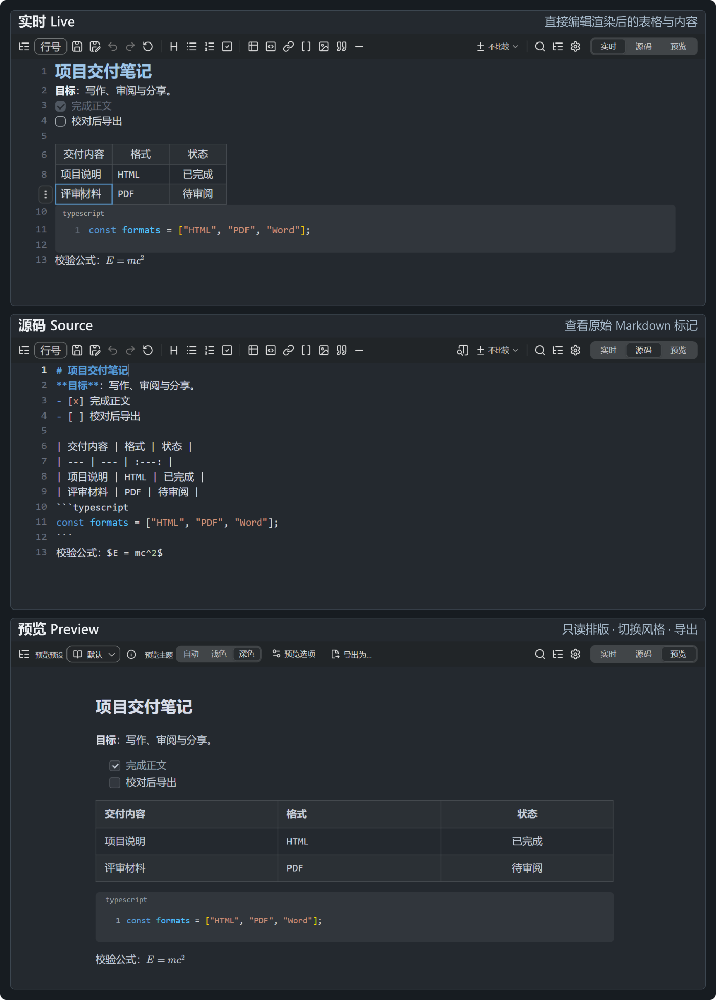
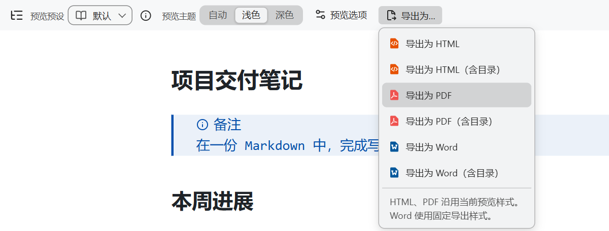
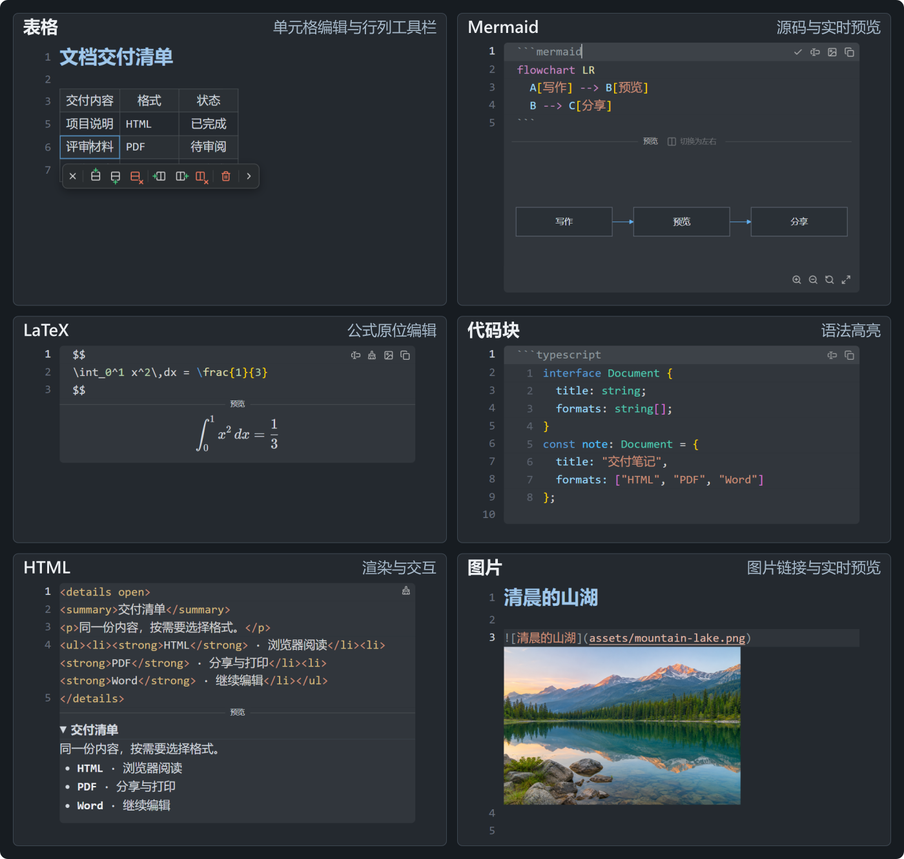
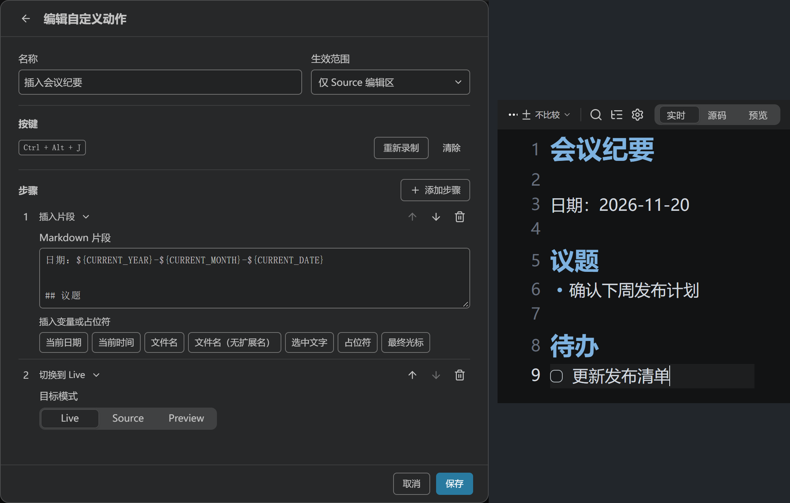
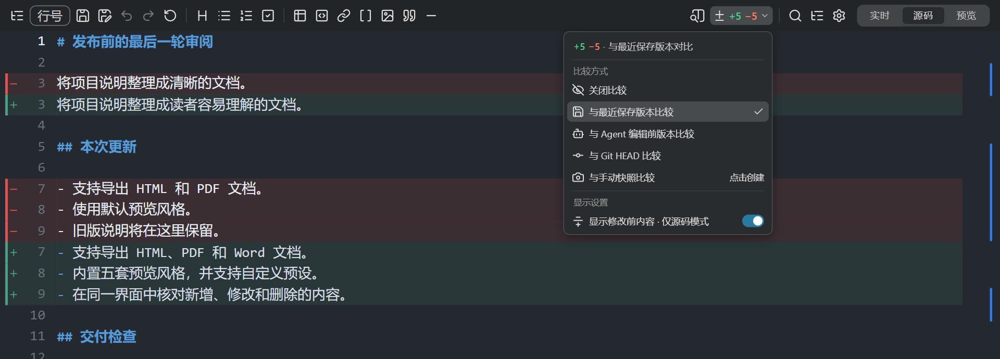

# MEO Enhanced

Write, preview, and review complex Markdown in VS Code. Move freely between Live, Source, and Preview modes, with in-place rendering and editing for tables, Mermaid diagrams, LaTeX formulas, HTML, and more.

在 VS Code 中流畅编写、预览和审阅复杂 Markdown。自由切换实时、源码与预览模式，在文档原位查看和编辑表格、Mermaid 图表、LaTeX 公式与 HTML 等内容。

<p align="center">
  <a href="https://github.com/huangko555/meo-enhanced/blob/main/README.md">English</a> · <strong>简体中文</strong> · <a href="https://github.com/huangko555/meo-enhanced/blob/main/CONTRIBUTING.md">贡献指南</a>
</p>

<p align="center">
  <a href="https://marketplace.visualstudio.com/items?itemName=huangko555.meo-enhanced"><strong>从 VS Code Marketplace 安装</strong></a> ·
  <a href="https://github.com/huangko555/meo-enhanced/releases">下载 VSIX</a> ·
  <a href="https://github.com/huangko555/meo-enhanced/blob/main/CHANGELOG.md">变更记录</a> ·
  <a href="#赞助">赞助</a>
</p>


## 一份文档，三种工作方式

| 模式 | 适合做什么 |
| --- | --- |
| **实时（Live）** | 直接在渲染后的文档中写作，编辑表格、图片、图表和公式。 |
| **源码（Source）** | 查看完整 Markdown，精确调整语法，或与预览分栏对照。 |
| **预览（Preview）** | 专注阅读，切换预览风格，并导出文档。 |

三种模式使用同一份内容，切换时保留阅读位置。资源管理器中的 **MEO Outline** 可在三种模式中跳转标题；底部状态栏显示行数与字数，实时和源码模式还支持选中字数统计。



## 导出 HTML、PDF 和 Word

写好 Markdown 后，在预览模式中点击 **导出为…**，选择交付格式。三种格式均提供**含目录**选项。

| 格式 | 使用场景 | 导出样式 |
| --- | --- | --- |
| **HTML** | 在浏览器中阅读与分享 | 沿用当前预览预设和配色 |
| **PDF** | 固定版式，便于分享和打印 | 沿用预设，并适配分页布局 |
| **Word（.docx）** | 交给他人继续编辑 | 使用固定文档格式 |

导出的 HTML 含 Mermaid 图表时会内嵌渲染引擎。只分享这个 HTML 文件，就能在启用 JavaScript 的现代浏览器里离线查看图表；外部链接和媒体仍依赖原有资源。



## 为文档选择风格，也可以制作自己的预设

内置 **默认、GitHub README、Typora Newsprint、Typora Whitey、Obsidian Minimal** 五套预览风格。同一份内容可以呈现为项目说明、纸面文章或简洁笔记。


想调整字体、颜色和排版，可以从仓库提供的示例开始，制作自己的预设：

1. 从[预设指南与示例](preview-presets/README.zh-CN.md)选择一套风格，修改配置和 CSS。
2. 点击预设菜单底部的 **自定义预设…**，进入管理页并导入预设文件夹。
3. 回到预览选择新预设；满意后导出 HTML 或 PDF，也可导出预设文件与他人分享。

预设用于独立预览、源码分栏预览及 HTML／PDF 导出。实时和源码编辑界面保留编辑器外观。

## 复杂内容，也能直接编辑



- **表格**：直接编辑单元格，增删行列、调整对齐与列宽，跨单元格选择和复制。长表格提供浮动表头与工具栏。
- **Mermaid**：在文档原位置展开源码和实时预览，切换上下或左右布局、拖动分栏；支持缩放、全屏及复制图片或源码。
- **LaTeX**：点击块级公式即可编辑源码并查看实时结果，支持公式补全预览与格式化。也可按需开启 `\(...\)` 和 `\[...\]` 公式语法。
- **代码块与 HTML**：代码块支持语法高亮、复制和长代码折叠；受支持的安全 HTML 可以原位编辑、预览与格式化。
- **图片**：支持本地与远程图片，剪贴板图片自动保存并插入；保存目录与命名规则可配置。

同时支持 Frontmatter Properties、GitHub Alerts、脚注、任务列表、Wiki 链接、`==高亮==` 和合并冲突处理。

更多用法见[设置与剪贴板说明](docs/editing-preferences.md)、[图片目录与命名设置](docs/image-storage.md)及[自定义预设指南](preview-presets/README.zh-CN.md)。界面提供简体中文与 English，可切换浅色、深色或跟随 VS Code，并调整字号与行间距。

## 用自定义动作串联常用操作

在 **全部设置 → 快捷键** 中选择 **新建动作**，用一个快捷键执行多个操作。

例如，在源码模式选中一行议题，用一个动作把它填入会议纪要模板，再切到实时模式查看结果。



内置示例 **插入当前时间**，默认快捷键为 `Ctrl+Alt+T`。[使用说明](docs/editing-preferences.md#自定义动作)

## 在编辑器中审阅改动

编辑器侧边显示新增、修改和删除标记，工具栏汇总变更数量，右侧概览标记帮助定位改动在全文中的分布。源码模式还可展开修改前的内容，结合上下文检查每处变化。



| 比较基线 | 适合的场景 |
| --- | --- |
| **最近保存版本** | 手动编辑时，检查尚未保存的改动 |
| **Agent 编辑前版本** | 检查 Agent 连续写入磁盘产生的改动 |
| **Git HEAD** | 与最新 Git 提交中的版本比较 |
| **手动快照** | 固定当前状态，审阅之后的改动 |

> **“Agent 编辑前版本”如何确定？**
>
> Agent 通常直接写入磁盘，因此需要与更早一次的保存内容比较。
>
> 10 秒内连续发生的磁盘写入视为同一轮修改，并使用这一轮首次写入前的版本作为基线；没有更早的保存记录时，回退到最近保存版本。

## 安装与开始使用

从 [VS Code Marketplace](https://marketplace.visualstudio.com/items?itemName=huangko555.meo-enhanced) 安装 **MEO Enhanced - Markdown 编辑器**，或在终端执行：

```shell
code --install-extension huangko555.meo-enhanced
```

安装后打开 Markdown 文件即可开始，也可以右键选择 **使用 MEO Enhanced 打开**。切换到预览模式，选择风格，再通过 **导出为…** 分享文档。

- 需要 **VS Code 1.94.0 或更高版本**。
- 支持 `.md`、`.markdown`、`.mdx` 和 `.mdc` 文件。
- 可与原版 MEO 同时安装，编辑器、命令和设置相互独立。
- 离线安装：从 [GitHub Releases](https://github.com/huangko555/meo-enhanced/releases) 下载 VSIX，在 VS Code 中执行 **Extensions: Install from VSIX...**。

<details>
<summary>同时安装其他 Markdown 编辑器时，如何设置默认打开方式？</summary>

使用 VS Code 的 **打开方式… → 配置默认编辑器** 选择首选编辑器。如果其他扩展在启动时改写编辑器关联，仍需禁用或修复该扩展，才能保留你的选择。

</details>

## 赞助

MEO Enhanced 免费开源。如果它对你有帮助，欢迎自愿赞助，支持持续开发与维护。

- **[爱发电（支付宝／微信支付）](https://afdian.com/a/meoenhanced)**：可自选金额。爱发电按月展示赞助，单次支持请选择 1 个月；金额和续费设置以付款页显示为准。
- **[Ko-fi（国际用户）](https://ko-fi.com/meoenhanced)**：一次性打赏，可自选金额。

赞助不附带会员权益或服务承诺。

## 项目来源与许可证

基于 [Markdown Editor Optimized（MEO）](https://github.com/vadimmelnicuk/meo) 开发，使用 [CodeMirror](https://codemirror.net/) 实现编辑功能，交互设计参考 [Obsidian](https://obsidian.md/)。项目采用 [MIT License](LICENSE)。
